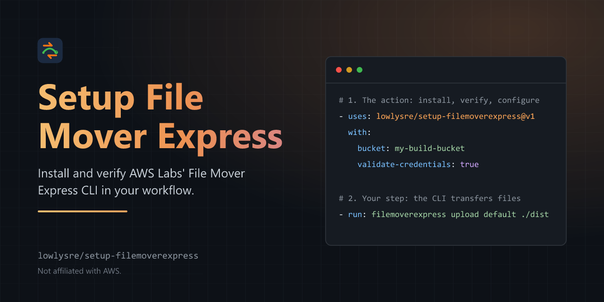

<p align="center">
  
</p>

<p align="center">
  <a href="https://github.com/lowlysre/setup-filemoverexpress/actions/workflows/ci.yml"></a>
  <a href="https://github.com/lowlysre/setup-filemoverexpress/actions/workflows/e2e.yml"></a>
  <a href="https://github.com/lowlysre/setup-filemoverexpress/actions/workflows/codeql.yml"></a>
  <a href="https://lowlysre.github.io/setup-filemoverexpress/"></a>
  <a href="LICENSE"></a>
</p>

# Setup AWS Labs' File Mover Express

Install the AWS Labs [File Mover Express](https://github.com/awslabs/filemoverexpress) CLI in GitHub Actions, add it to `PATH`, and optionally configure an S3 transfer profile. The action verifies the download against its SHA-256 digest and, on Windows and macOS, Amazon's code signature. It doesn't perform transfers itself: your workflow runs the CLI.

This action is built and maintained by [lowlysre](https://github.com/lowlysre). It's an independent project, not affiliated with or endorsed by AWS.

## Quick start

This example assumes the repository can use GitHub OIDC to assume an AWS role and that `dist` contains the files to upload. See the [first-upload tutorial](docs/tutorials/first-upload.md) to configure the OIDC trust policy and bucket permissions.

```yaml
permissions:
  contents: read
  id-token: write

steps:
  - uses: aws-actions/configure-aws-credentials@v6
    with:
      role-to-assume: ${{ secrets.AWS_ROLE_ARN }}
      aws-region: us-east-1

  - uses: lowlysre/setup-filemoverexpress@v1
    with:
      bucket: my-build-bucket
      validate-credentials: true

  - name: Upload build output
    shell: bash
    run: |
      filemoverexpress upload default ./dist 2>&1 | tee fme.log
      if grep -qE $'^(\033\\[[0-9;]*m)*(ERROR|FATAL)' fme.log; then
        echo "::error::File Mover Express reported transfer errors"
        exit 1
      fi
```

The setup action takes the region and credentials from the AWS environment configured by the preceding step. Pin third-party actions to full commit SHAs in production workflows.

File Mover Express exits `0` when individual files fail to transfer. The upload step checks the log and fails on `ERROR` or `FATAL` lines. See [fail on transfer errors](docs/how-to/fail-on-errors.md) for other checks.

## File Mover Express or the AWS CLI

File Mover Express copies files between the runner and S3. The AWS CLI and [s5cmd](https://github.com/peak/s5cmd) cover jobs it doesn't.

| Need                                                        | File Mover Express                                 | AWS CLI or s5cmd              |
| ----------------------------------------------------------- | -------------------------------------------------- | ----------------------------- |
| Upload or download a directory or prefix                    | ✅                                                 | ✅                            |
| Mirror a directory and delete what's gone (`sync --delete`) | ❌                                                 | ✅                            |
| Filter by regex or file age (`--filter`, `--max-age`)       | ✅                                                 | Glob include and exclude only |
| Store XXH3, XXHash, or MD5 checksums                        | ✅                                                 | ❌                            |
| Copy between buckets, manage objects, presign URLs          | ❌                                                 | ✅                            |
| Fail the step on a failed transfer                          | Needs a [log check](docs/how-to/fail-on-errors.md) | ✅ Non-zero exit              |

You can use both in one job. See [Sync or delete](docs/how-to/transfers.md#sync-or-delete).

## Documentation

Full docs are at [lowlysre.github.io/setup-filemoverexpress](https://lowlysre.github.io/setup-filemoverexpress/).

- [Your first upload](docs/tutorials/first-upload.md)
- [Inputs and outputs](docs/reference/inputs.md)
- [Authenticate with configure-aws-credentials](docs/how-to/aws-credentials.md)
- [Upload and download faster](docs/how-to/transfers.md)
- [Security model](docs/explanation/security.md)

## License

Copyright 2026 lowlysre. This action is licensed under the [Apache License 2.0](LICENSE); see [NOTICE](NOTICE) for attribution. It downloads and runs the File Mover Express CLI, which has its own [Apache-2.0 license](https://github.com/awslabs/filemoverexpress/blob/main/LICENSE). Third-party code bundled into the action is listed in [dist/THIRD_PARTY_LICENSES.txt](dist/THIRD_PARTY_LICENSES.txt).

AWS and Amazon S3 are trademarks of Amazon.com, Inc. or its affiliates. This project is independent and not affiliated with or endorsed by AWS.
